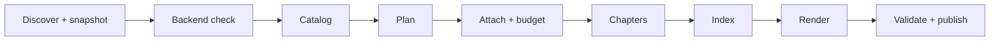

# repo-summarize

Turn a codebase into a short, ordered book of Markdown files that a developer reads to learn how to work in it.

`repo-summarize` is a single-file, stdlib-only Python 3.12+ tool run by `uv`. It scans the repository without AI, then asks an AI CLI to catalog the files, plan chapters and write each chapter as structured JSON. The tool itself renders the Markdown, pastes the code excerpts from a snapshot of your files, and publishes `docs/architecture/`.

## The book

```text
docs/architecture/
├── INDEX.md            overview, system diagram, chapter table
├── 01-orientation.md   what it is, stack, layout, install/run/test/build
├── 02-main-flow.md     one path from an entry point to an output
├── 03-<slug>.md …      0-9 subsystem chapters
├── NN-contributing.md  CI gates, conventions, PR flow
├── FILES.md            every included file, skipped files and reasons
├── UNCERTAINTIES.md    what the labels did not check
└── provenance.json     run, backend and sandbox record
```

Chapters use fixed headings (What this is, How it fits together, How it works, Where to change things, Gotchas) and end with a footer of primary files, related files, tests and related chapters. Maximum 12 chapters. Hand-written files in `docs/architecture/` are kept, except names the tool reserves (`INDEX.md`, `FILES.md`, `UNCERTAINTIES.md`, `provenance.json`, `NN-*.md`, `reference/`): an unmarked file with a reserved name stops the run without publishing.



The backend is called in Catalog, Plan, Chapters and Index, plus one probe call in the backend check (when the backend fingerprint changes, see Safety) and an occasional plan re-ask during Attach.

## Install

```bash
git clone https://github.com/ne1cc/repo-summarize.git
./repo-summarize/install.sh
```

Requires [`uv`](https://docs.astral.sh/uv/) (the script header declares Python >= 3.12 and no dependencies), `git` recommended, and an AI CLI with a print mode.

## Usage

```text
repo-summarize [path]     build and publish the book
  --estimate              calls per stage and prompt size; no AI calls, no writes
  --dry-run               discovery and coverage only; no writes
  --status                last run, publish journal, published run; recovers an interrupted publish
  --max-calls N           stop before call N+1; exit 4; nothing published
  --force                 ignore the generation cache
  --replan                ignore plan reuse
  --open                  open INDEX.md after publishing
  --clean                 delete docs/.repo-summarize/
  --unsafe-backend        allow a non-sandboxed backend or yolo flags
```

| Env | Default | Meaning |
|---|---|---|
| `REPO_SUMMARIZE_CMD` | `agy --disable-slash-commands -p` | Backend command, split like a shell; the prompt is appended as the last argument. Under the sandbox, the command and anything it runs must live outside `$HOME` or under `~/.local`, `~/.gemini`, `~/.antigravity` or `~/Library` (exit 126 otherwise) |
| `REPO_SUMMARIZE_TIMEOUT` | `300` | Seconds per backend call |
| `REPO_SUMMARIZE_PASS_ENV` | none | Extra environment variable names to pass to the backend (it otherwise gets only PATH, HOME, LANG, TMPDIR) |
| `REPO_SUMMARIZE_CACHE_NAMESPACE` | none | Mixed into the cache key |

**Picking a backend.** The default works with agy, so `REPO_SUMMARIZE_CMD` is optional. To use another print-mode CLI, export it in your shell profile, for example `export REPO_SUMMARIZE_CMD="claude -p"` in `~/.zshrc`. If a run says `backend command not found: <cmd>`, the variable holds a stale value: shells that were already open keep what they had before you edited the profile. Run `unset REPO_SUMMARIZE_CMD` in those, or just open a new terminal.

**Wrappers and symlinks.** The sandbox checks the resolved path, not the path you typed. A wrapper such as `~/.local/bin/mywrap -> ~/Github/dotfiles/bin/mywrap` is allowed by name but its target is under `$HOME`, so every call fails with `exit 126: cannot execute the backend command inside the sandbox` and the run aborts after 3 failures. Point `REPO_SUMMARIZE_CMD` at a real file under `~/.local` or outside `$HOME`, or use the default. A wrapper that adds `--dangerously-skip-permissions` hides the flag from the yolo check, so the tool's safety model no longer applies.

**Progress.** Stage lines go to stderr (`cataloging files`, `planning chapters`, ...). Inside a stage, each backend call prints `<stage>: call N[/cap] started (H cached so far)` and then `done in Xs` or `failed after Xs: <reason>`; cached replies print nothing. Each call also writes a `secs` field to `docs/.repo-summarize/runs/<run_id>/log.jsonl`, which you can `tail -f` from another terminal.

Exit codes: 0 published, 1 failed, 2 usage, 3 aborted (3 consecutive call failures), 4 capped by `--max-calls`, 5 backend unsafe.

Private state lives in `docs/.repo-summarize/` (mode 0700, contains a `.gitignore` of `*`, so it is never committed). The published book `docs/architecture/` is also left in the target repo on purpose: commit it, or add `docs/architecture/` to that repo's `.gitignore` if you don't want it in version control. Snapshots are deleted at the end of each run, cached replies are 0600, and logs hold sizes, hashes and labels, never prompt or reply bodies. The last 3 run logs are kept.

## Safety model

The default backend is `agy --disable-slash-commands -p`; agy takes the next argument as its prompt and has no stdin input. Behaviour observed with agy 1.4.3 on macOS (2026-10-21):

| Layer | Status |
|---|---|
| Writes and shell commands | agy auto-denies them in print mode, unless your agy settings contain allow-rules |
| File reads | not restricted by agy: it can read files anywhere on disk, and agy's own flags do not prevent this |
| OS sandbox | the tool runs every backend call under it (below) |

- **macOS:** every call runs under `sandbox-exec`. Reads under `$HOME` are denied, except `~/.gemini`, `~/.antigravity`, `~/.local`, all of `~/Library`, and the `$HOME` directory listing itself. The repo root and state dir are denied for both reads and writes. Reads outside `$HOME` (for example `/etc`, `/tmp`) are not restricted. Writes are allowed only in `/dev`, temp dirs, `~/.gemini`, `~/.antigravity`, `~/Library/Caches` and `~/Library/Application Support`; writes to agy's `settings.json` are denied.
- **Linux:** uses `bwrap` if installed. This is implemented but has not been tested on Linux.
- **No sandbox available**, or a yolo flag such as `--dangerously-skip-permissions`: the run exits 5 unless you pass `--unsafe-backend`.
- The backend fingerprint covers the command, backend version, sandbox profile, deny paths, adapter version and `REPO_SUMMARIZE_CACHE_NAMESPACE`. The fingerprint includes the repo root and state directory, so each new repository gets one probe call on its first run. When the fingerprint changes, the tool makes one probe call asking the backend to read a sentinel file under `$HOME`. This is a regression check, not authorization. If access is observed under an active sandbox, the run stops with exit 5. A probe the backend cannot complete (non-zero exit or timeout) stops the run with exit 1, so the failure is reported once instead of surfacing as repeated call failures. Access-observed and failed probes are never cached, so every run probes again until a probe comes back clean.
- The sandbox does not restrict network access or starting other programs.
- If your agy settings contain allow-rules (for example `command(...)`), they widen what agy may do. The tool lists them in `provenance.json`.

Files such as `.env*`, `*.pem`, `*.key`, `secrets/**` are never read. Common token and key patterns are replaced with `[REDACTED]` on the same line, so line numbers do not change.

## Limits

- Labels check structure, not truth. A reference label means the cited lines exist, an identifier occurs near the cited line, or an import path connects two files. It does not mean the explanation is correct.
- A real but wrong recommendation (a function that exists but is the wrong one to change) cannot be detected.
- Redaction is best-effort and can miss secrets.
- Repository content is sent to the configured backend. Do not run this on code you may not share with it.
- agy keeps its own conversation history (under `~/.gemini`); the tool cannot control that.
- The import graph is heuristic and covers Python, JS/TS, Lua, shell and C/C++ only. Other languages are still cataloged, but contribute no edges.
- Calls run one at a time, so large repositories take a while. Re-runs reuse cached replies.
- Publishing is recoverable, not atomic: an interrupted publish is restored by the next run (or `--status`).
- No complete-book acceptance run against real agy had been done when this was written.

## v2.1 roadmap

- Per-file `--reference` walkthroughs (planned default: top 20 files by fan-in; `--reference all` for everything)
- Go, Rust and Java/Kotlin import extractors
- Snapping excerpts to the enclosing `def`
- Automatic chapter splitting
- Cache pruning
- A richer `--status`

## Migrating from v1

- Per-file docs are no longer generated. On the first v2 publish, files generated by earlier versions in `docs/architecture/` are removed; hand-written files are kept.
- `--filter` and `--max-files` are removed.
- The Bash script is gone. Install through `uv` as above; `bash tests/smoke.sh` is replaced by pytest.

## Development

```bash
uv run --with pytest pytest -q   # offline, uses a stub backend
```

See [CHANGELOG.md](CHANGELOG.md). Design: `docs/superpowers/specs/2026-10-20-book-mode-design.md`.

## License

[MIT](LICENSE)
