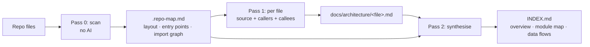

# repo-summarize

Turn any codebase into an **annotated architecture walkthrough** with one command.

`repo-summarize` is a single-file Bash tool. It maps your repository without any AI, then asks an AI CLI of your choice to explain every source file *in the context of its callers and callees*, and finally synthesises an architectural `INDEX.md`. Output is plain Markdown in `docs/architecture/`, so it diffs, greps, and renders anywhere.

```text
$ repo-summarize        # example output
Repo map: docs/architecture/.repo-map.md (212 files, 640 import edges)
🧠 [1/212] Summarizing: src/server.ts (88 lines, line mode) → docs/architecture/src/server.ts.md ...
...
✓ All summaries generated!
```

## Why it's different

- **Scan first, explain second.** Pass 0 costs zero tokens: it builds a repo map (layout, entry points, heuristic import graph). Every per-file prompt then carries that file's callers, callees and siblings, so explanations say *why a file exists*, not just what it does.
- **Annotated walkthroughs, not blurbs.** Files of 150 lines or fewer get a comment above every source line; longer files get per-block explanations. The prompt forbids modifying the source and requires "unknown" over invention.
- **Backend-agnostic.** Any CLI that takes a prompt as its last argument and prints a reply works (`REPO_SUMMARIZE_CMD`). Default: `agy -p`.
- **Resumable and honest.** Failed files are logged and skipped, never saved as junk. Finished files are cached and re-run only when the source is newer. If INDEX synthesis fails, your existing `INDEX.md` is left untouched and the exit code is non-zero.
- **Zero dependencies beyond Bash.** Tested on macOS with its stock bash 3.2; Linux code paths exist (`fd`/`git`/`find`, `xdg-open`) but are less exercised.

## How it works



## Requirements

- Bash 3.2+ (macOS default is fine), `git` recommended.
- An AI CLI with a non-interactive print mode, such as `agy` (default) or `claude`.
- Optional: `fd` (faster discovery), `jq` (prettier `--status`).

## Install

```bash
git clone https://github.com/ne1cc/repo-summarize.git
ln -s "$PWD/repo-summarize/bin/repo-summarize" ~/.local/bin/repo-summarize   # or any dir on PATH
```

## Usage

```bash
repo-summarize                    # summarize the current git repository
repo-summarize /path/to/repo      # target another repository
repo-summarize --dry-run          # scan only: write the repo map, make no AI calls
repo-summarize --max-files 20     # cap the run (sampled across top-level directories)
repo-summarize --filter src/api   # only summarize paths containing a substring
repo-summarize --force            # regenerate existing summaries
repo-summarize --status           # progress of a running or finished run
repo-summarize --open             # open INDEX.md when done (omd, One Markdown, glow, or xdg-open)
```

### Choose your AI backend

The prompt is appended as the last argument:

```bash
REPO_SUMMARIZE_CMD="claude -p" repo-summarize
REPO_SUMMARIZE_CMD="agy -p --model <model>" repo-summarize
```

Use a read-only, non-interactive mode. This tool never needs the model to run tools or edit files, so **do not** pass flags such as `--dangerously-skip-permissions`.

## Output

```text
docs/architecture/
├── INDEX.md              # AI-synthesised architectural overview (Mermaid module map, data flows)
├── .repo-map.md          # zero-AI repo map: layout, entry points, import graph, line counts
├── .repo-edges.tsv       # importer<TAB>imported pairs
├── .progress.json        # live status read by --status
└── <path/to/file>.md     # one annotated walkthrough per source file
```

A short file's walkthrough (excerpt from a real run):

````markdown
```py
# » Imports peer module `b` so that this module can reference its namespace and access attributes like `b.x`.
import b

# » Defines the `main()` function encapsulating the primary execution logic of displaying `b`'s state.
def main():
    # » Reads `x` from module `b` and prints it to standard output.
    print(b.x)
```
````

Languages scanned: py, ts/tsx, js/jsx, go, rs, lua, sh/zsh, sql, c/c++/h/hpp, java, kt, swift, cmake. Import edges are heuristic (py, js/ts, lua, sh/zsh, c/c++); ambiguous or external imports are omitted rather than guessed. Lockfiles, minified assets, images and common build directories (`node_modules`, `dist`, `build`, `target`, `vendor`, ...) are skipped.

## Privacy and security

- **Your source code is sent to whatever AI provider your backend CLI uses.** Do not run this on code you are not allowed to share with that provider.
- Repository contents become part of the prompt. A malicious file could contain prompt-injection text, which is why the default backend runs without skipping permissions. Review the generated docs before publishing them.

## Known limitations

- Some models write absolute `file://` links into the generated docs. Those embed local paths; strip or rewrite them before committing the output.
- Prompts are passed as one argument and capped at 110 KB. A file that exceeds this even without dependency excerpts is skipped and reported.
- Per-file calls run sequentially. Large repositories take a while; use `--max-files` or `--filter`, and re-run to resume.

## Development

```bash
bash tests/smoke.sh     # offline: all three passes against a stub AI backend
```

History: v1 (headless per-file summaries and an index) → full coverage with an AI-synthesised index → progress tracking and `--status` → scan-first annotated walkthroughs with the import graph and reliability fixes. See [CHANGELOG.md](CHANGELOG.md).

## License

[MIT](LICENSE)
